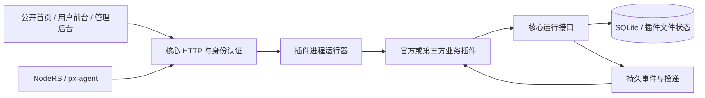

# 架构与边界

## 功能组织

PxBoard 参考成熟面板的能力划分，采用自己的接口和插件协议：

| 参考项目                                                                            | 参考的能力组织                                     |
| ----------------------------------------------------------------------------------- | -------------------------------------------------- |
| [Xboard](https://github.com/cedar2025/Xboard)                                       | 套餐、订单、支付、推广、用户服务与插件生命周期     |
| [SSPanel UIM](https://github.com/Anankke/SSPanel-UIM)                               | 额度、到期、周期流量、充值、邀请、通知和多格式订阅 |
| [x-ui](https://github.com/vaxilu/x-ui) / [3x-ui](https://github.com/MHSanaei/3x-ui) | 节点、客户端、内核运行、配置同步与访问日志         |

源面板兼容仅存在于独立迁移插件的字段转换中。运行中的 PxBoard 不提供 Xboard 或 SSPanel 的兼容 API，NodeRS 通过 PxBoard 原生机器接口对接。

## 组成

后端使用 Go，核心 HTTP 服务基于标准库，持久存储为 SQLite。界面使用 React、TypeScript 和 Ant Design。当前部署模型是单个核心实例管理本地插件进程，数据库使用 WAL。

### 核心职责

核心维护账号、密码验证、动态验证码验证、会话、角色、API 密钥、站点设置、操作记录、插件源、安装状态、插件运行、持久事件、通用记录存储和迁移提交能力。模式配置负责读取来源中的安装组合、解析依赖、报告安装结果和切换当前模式。

核心后端不导入官方业务 Go 包。套餐定价、订单处理、支付商户、订阅生成、访问权益、节点规则和工单逻辑分别属于插件。

### 业务插件

每个插件单独编译为可执行文件，单独安装和启停。主进程通过标准输入输出传送逐行 JSON 请求与响应，日志写到标准错误。请求正文使用 JSON 的字节编码保留原始内容，Go 的 `[]byte` 在传输中编码为 Base64，因此表单回调和其他二进制正文可以原样恢复。

SDK 将请求还原为标准 `http.Request`，插件可以使用普通 HTTP 路由和处理器。通信按请求 ID 匹配响应，单次请求超时不会终止其他请求或插件进程。SDK 默认按到达顺序处理请求；只有通过 `ConcurrentPaths()` 明确声明的方法和路径并发执行。余额、权益、回调等状态变更仍由默认队列串行处理。长任务使用持久任务状态；插件之间不要建立循环同步调用。

启动时进行健康握手，插件接口版本必须匹配。安装与升级检查标识、平台、版本和最低依赖；失败时保留可恢复的先前声明及版本文件。停用和卸载保留业务数据，存在已启用依赖方时拒绝直接停用被依赖插件。

### 界面

主项目包含公开页面、按模式独立装载的自用与商业用户前台、管理员布局及声明式页面渲染器。两个前台分别定义导航和页面，订阅、账户及其他公共能力共用；商业前台提供套餐、结算、余额和订单操作。业务结果仍由对应插件的接口决定，用户前台不提供管理后台入口。

插件通过声明式页面提供自己的导航、角色、字段、资源、操作和概况。安装插件无需重新构建声明式页面渲染器。当前不在线加载任意第三方前端脚本包；第三方页面扩展与官方定制用户流程的范围分开。

## 模式与插件安装

官方源提供 `personal` 和 `business` 两个组合，组合内容归源仓库维护。核心模式接口按选定来源解析整个依赖集合，下载当前平台产物并启用插件；只有所需功能安装成功后才变更当前模式。

安装状态持久保存，页面可以查询每个插件的状态。中断或失败后重试会继续处理所需安装内容，而不会清空业务记录。切换模式也不会自动卸载其他插件，避免把曾经启用的运营数据或自行添加的扩展删除。

模式成功配置后，核心发布 `workspace.configured` 事件。访问插件为自用管理员补充尚不存在的默认访问账户；商业插件提供公开套餐，独立注册插件控制账号注册。事件由后台队列处理，账户状态更新存在短暂处理延迟。登录后的默认入口为 `/user`，管理页面使用独立后台地址，商业模式可自定义入口。模式、注册开关和插件启停的具体含义见 [模式说明](modes.md)。

## 身份与权限

核心验证浏览器会话或 API 密钥，再将可信身份传给插件。插件必须自行校验操作角色、记录所属用户和跨插件调用来源；前端隐藏按钮不能代替服务端权限。

插件运行令牌在启动时生成，通过环境变量注入。存储接口固定到调用插件自己的命名空间。读取用户、创建用户、跨插件调用和发布事件分别要求显式权限。内部 `/_...` 路径不能通过公开扩展路由访问。

公开业务接口由 `publicPaths` 声明，按完整路径或路径段前缀匹配。公开套餐接口只返回可公开的在售字段；原迁移记录、购买规则和内部配置不进入公开响应。

插件进程拥有面板服务系统用户的权限，独立进程不是操作系统沙箱。核心权限限制核心接口的访问范围，不阻止插件直接访问系统资源。插件源、作者和声明权限都属于安装信任的一部分。

## 数据与事件

用户身份属于核心，业务文档使用 `namespace / collection / id` 保存。插件使用稳定记录 ID 实现重复执行安全；计数操作在数据库事务中累计，并以操作标识去重。文件型状态放在 `plugins/<id>/state/`，与版本目录分开，升级不更换状态位置。

插件通过 `Commit` 在同一事务中保存自己的业务记录并登记事件，以稳定操作编号去重。核心同时校验存储和事件权限；任何一项失败都会整体回滚。不同接收插件分别投递，每个接收插件按事件登记顺序处理一批，避免慢插件占住其他插件的投递队列。失败投递逐步延长重试间隔，达到重试次数后保留任务供管理员处理。每分钟的调度事件用于流量重置、订单补偿、通知投递和记录清理。事件可能重复投递，消费者仍按业务标识去重。

支付插件验证回调后发布事件；商业插件再检查订单金额与币种，然后发放权益。权益按订单 ID 去重，余额支出、充值、退回余额和佣金使用稳定账本标识。跨插件流程依靠持久状态和重试完成，不使用跨进程数据库事务。

全部接收方处理成功后清空事件正文，已完成事件元信息保留 30 天；未完成事件保留正文以便恢复。流量额度维护周期累计值，不依赖逐连接日志计算。审计记录是独立用途的数据，不代替流量账本。

## 迁移提交

迁移插件负责源数据库读取、冻结快照、字段转换和预览报告，核心只提供经授权的暂存、检查与提交接口。迁移插件需要 `import:users` 及各目标命名空间的权限，不能借普通存储接口任意写入其他插件数据。

核心检查暂存完整性、用户标识与邮箱、记录冲突及目标插件状态；业务集合的必填字段、唯一字段和用户归属由目标插件的 `importRules` 声明。导入插件用 `requiredImportRules` 声明必须存在的校验，目标插件未更新时阻断导入。核心在一个 SQLite 事务中完成检查和写入，保持原密码元数据与业务文档，不覆盖已有记录，也不重放历史订单。已经提交的同一任务再次执行返回已提交状态。

原密码和可识别的动态验证码配置由核心验证。旧密码验证成功后可以升级为当前密码编码，连接 UUID、独立连接密码与登录密码分别保存。未转换原表留在插件归档和冻结快照中；迁移不是源数据库备份的替代品。

## 节点接口与状态

NodeRS 机器接口位于 `/api/v1/extensions/nodes/machines/{machineId}`，使用 `X-Machine-Key`。节点配置分为监听、传输、安全和协议选项，用户凭据分为 UUID 和连接密码。流量提交包含唯一批次编号，NodeRS 本地保存待确认批次，节点插件和访问插件分别执行去重处理。

机器、节点和数字账户编号具有不同用途，不能用核心用户字符串 ID 代替。迁移保留源数字编号，目标编号冲突会阻断。

状态监控由节点插件实现。心跳、负载和在线账户均来自上报，缺失数据保持为空；普通用户仅得到有权节点的使用状态，管理员可以得到机器和错误详情。状态接口不主动探测外部网络。

## 仓库边界

| 仓库               | 负责内容                                       |
| ------------------ | ---------------------------------------------- |
| `PxBoard`          | 核心、公开 SDK、共享界面与声明式页面渲染       |
| `PxBoard-Plugins`  | 官方业务插件、迁移工具和官方节点代理           |
| `PxBoard-Registry` | 模式组合、插件索引、发布工具与平台产物         |
| NodeRS             | 独立的节点协议运行与 PxBoard / Xboard 接口适配 |

插件源可以静态托管，官方插件可以独立发布。源码分仓不要求每次启动都把业务包编译进核心；服务器安装的是与平台匹配的插件产物。
